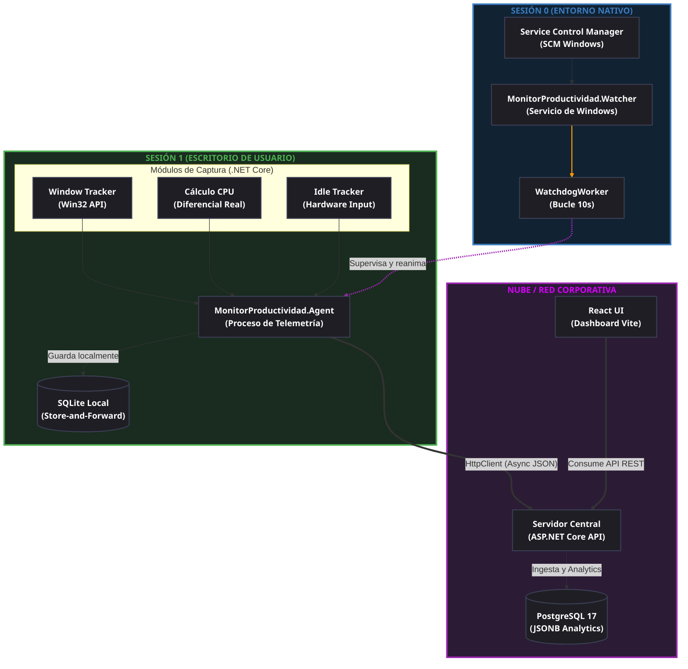

# Sistema Distribuido de Telemetría y Monitoreo de Productividad (Framework SPACE)

Sistema cliente-servidor desacoplado para la captura automatizada de telemetría de bajo nivel en estaciones de trabajo Windows y el análisis de productividad en equipos de desarrollo de software, fundamentado en el **Framework SPACE** (Actividad, Eficiencia y Flujo, y Señales de Rendimiento).

## 🛡️ Privacidad por Diseño (*Privacy by Design*)

Este proyecto fue concebido bajo estrictos lineamientos éticos de monitoreo en entornos corporativos:
* **Sin Keylogging:** Queda expresamente excluida la captura de pulsaciones de teclado o lectura de búferes de texto.
* **Sin Vigilancia Visual/Auditiva:** No se realizan grabaciones de pantalla continuas ni se accede a periféricos audiovisuales (cámara/micrófono).
* El monitoreo se limita **estrictamente a metadatos** de ventanas, procesos y consumo de recursos de hardware.

## ✨ Características Principales

* **Captura Automatizada de Bajo Nivel:** Extrae el foco de la ventana activa, enumera aplicaciones concurrentes y calcula el consumo diferencial de CPU y memoria RAM mediante llamadas nativas a la Win32 API (`user32.dll`).
* **Detección Determinista de Inactividad (FSM):** Máquina de Estados Finitos que evalúa el tiempo sin interacción física de hardware (`GetLastInputInfo`). Al superar el umbral, conmuta el registro al proceso sintético `idle.exe` (0% CPU).
* **Tolerancia a Fallos (*Store-and-Forward*):** Persistencia síncrona en una base de datos local SQLite y transmisión asíncrona en lotes (Batching HTTP) cada 5 minutos, garantizando resiliencia ante cortes de red.
* **Protección Recíproca Inter-Sesión (Watchdog):** Servicio de Windows en Sesión 0 (SYSTEM) que vigila la salud del Agente recolector en Sesión 1, reanimándolo ante cierres forzados.
* **Hardware-Based Policy Management:** Asignación de perfiles y listas de aplicaciones autorizadas basadas en la dirección física inmutable de la tarjeta de red (MAC Address).

## 🏗️ Arquitectura y Estructura del Monorepo

El proyecto unifica cuatro módulos principales utilizando una arquitectura híbrida de microservicios y clientes ligeros:

```text
Tesis1_MT/
├── MonitorProductividad.sln             # Solución unificada para los proyectos C#
├── MonitorProductividad.Agent/          # Agente recolector local (.NET 10 - Sesión 1)
├── MonitorProductividad.Watcher/        # Servicio guardián Watchdog (.NET Worker - Sesión 0)
├── MonitorProductividad.Server/         # Backend REST API central (ASP.NET Core Minimal APIs)
├── monitor-dashboard-ui/                # Panel analítico web (React 18 + Vite + Tailwind v4)
└── docker-compose.yml                   # Orquestación local para PostgreSQL 17
```

## 📊 Diagrama de Flujo y Componentes



## 🚀 Guía de Despliegue Local (Desarrollo)

### 1. Base de Datos (PostgreSQL)
Levanta la infraestructura de persistencia mediante Docker:
```bash
docker compose up -d
```

### 2. Backend Central (API REST)
Aplica las migraciones de Entity Framework Core para construir las tablas (incluyendo soporte nativo `JSONB`) y ejecuta el servidor:
```bash
cd MonitorProductividad.Server
dotnet ef database update
dotnet run
```
*El servidor escuchará en el puerto configurado (ej. `http://localhost:5259`).*

### 3. Frontend Web (React + Vite)
Instala las dependencias de Node.js y arranca el entorno de desarrollo:
```bash
cd monitor-dashboard-ui
npm install
npm run dev
```
*El dashboard estará disponible en `http://localhost:5173`.*

### 4. Agente Local
Inicia el agente de escritorio para comenzar a capturar métricas y despacharlas al servidor central:
```bash
cd MonitorProductividad.Agent
dotnet run
```

## ☁️ Estrategia de Despliegue en Producción
El monorepo está diseñado para despliegues independientes por componente:
* **Frontend:** Preparado para *Vercel* configurando `monitor-dashboard-ui` como *Root Directory*.
* **Backend:** Preparado para *Koyeb* o *Render* configurando `MonitorProductividad.Server` como *Work Directory*.
* **Base de Datos:** Compatible con *Supabase* u otros proveedores de PostgreSQL gestionado.
